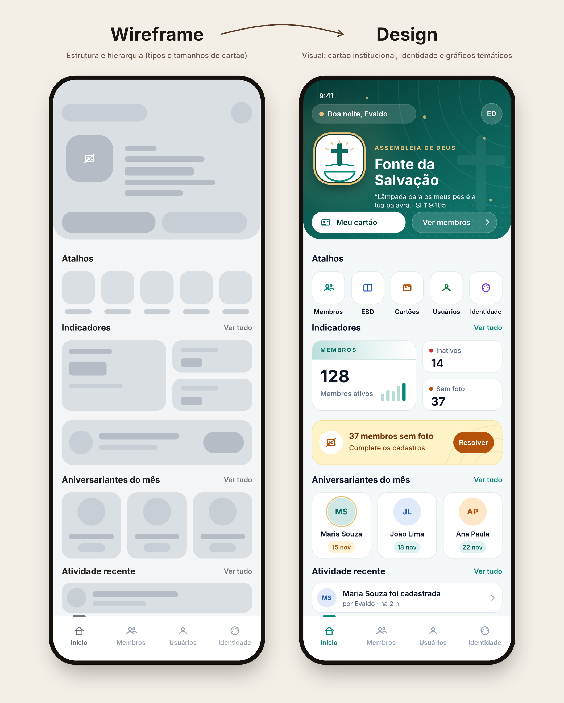

# Início (Home) — wireframe a seguir

> **Para qualquer conta/sessão que retome o trabalho de UI:** a Início tem um desenho **aprovado pelo dono do projeto** e já implementado. Ele é a referência da tela e o modelo de "tela planejada" (tipos e tamanhos de card diferentes, hierarquia clara, um ponto focal). Ao mexer na Início, **siga a imagem** `docs/img/home-wireframe-design.png`. Ao desenhar as outras telas, use a mesma lógica.

**Exceção aprovada:** na imagem o cartão verde tem dois botões embaixo ("Meu cartão" e "Ver membros"). O dono pediu para **removê-los**. Não recolocar.

## Estrutura (de cima para baixo)

1. **Cartão institucional** (`.hm-hero`) — **de borda a borda, colado ao topo** (só os cantos de baixo arredondados), **logo centralizado em cima** do nome, sem barra superior (a topnav fica oculta só na Início: `renderView` em `index.html`).
   - Fundo: degradê profundo da **cor da igreja** (`--hero-a`/`--hero-b`, calculados em `aplicarIdentidade()` escurecendo `COR_PRIMARIA` até o texto branco ter contraste ≥ 5:1). Dourado de apoio: `--hero-gold`.
   - Linha de cima: pílula "Bom dia, Nome" + botão redondo com as iniciais do usuário. O botão abre o **menu do usuário** (Alterar senha, Alternar tema, Sair) — é o substituto da topnav.
   - Marca: **logo 88 px** (72 px no celular) com anel dourado (`IDENTIDADE.logoUrl`, ou iniciais se não houver), eyebrow (visão do perfil), **nome da igreja** e **lema**.
   - Grafismo temático em SVG (`_homeArte()`): arcos concêntricos, cruz em marca d'água, malha de pontos e brilhos. Só formas; sem animação infinita.
2. **Atalhos** (`.hm-mods`/`.hm-mod`) — módulos liberados ao perfil + Usuários (admin). **Compactos** (ícone 56 px + rótulo, ~5 por linha no celular; **mesmos destinos do menu**: módulos, Usuários, Identidade — vêm de `navItens()`; **a barra inferior do celular não aparece na Início**, os atalhos a substituem) com **ícone preenchido** (traço + preenchimento translúcido).
3. **Indicadores em mosaico** (`.hm-bento`, `#kpi-grid`) — 1 cartão **destaque sólido na cor da igreja** (Membros ativos, número grande, ícone-marca d'água e brilho) + cartões menores **coloridos por assunto** (o destaque não tem chip de ícone: só a marca d'água; número à esquerda) (rótulo curto; cor `kc-*` do servidor: chip de ícone, degradê suave, ícone-marca d'água). Cartão compacto: ícone à esquerda, rótulo e número à direita. Vêm de `getKpisHome`. Indicadores marcados `alerta: true` no servidor não viram cartão: viram a **faixa âmbar** abaixo ("N membros sem foto · Resolver" → abre Membros).
4. **Aniversariantes do mês** — 3 cartões lado a lado (iniciais, nome, data), "Hoje" em dourado. Endpoint novo `mb_aniversariantesDoMes(token, 3)` (`Membros.js`): só nome + dia/mês + `hoje`, só ativos, exige sessão. Só aparece para perfis com o módulo Membros.
5. **Atividade recente** (painel, só admin) — `getAtividadeRecente`.

Mosaico: com exatamente 3 indicadores, destaque à esquerda e 2 menores empilhados à direita (também no celular); com outra quantidade, destaque em linha inteira e menores em 2 colunas.

**Fundo geral (tema claro): `#F1F1F1` liso** (sem degradê azulado, sem grade e sem orbes) — vale para todas as telas.

## Regras que se mantêm
- Só tokens (`--sp-*`, `--fs-*`, `--r-*`, `--dur*`); nada de cor fixa além das `--hero-*` do shell.
- ES5, avisos pelos modais/toasts da plataforma, estados de carregando/vazio/erro em cada bloco (`_homeEstado`, esqueleto).
- Nenhuma animação infinita na Início; `prefers-reduced-motion` respeitado.
- Conteúdo por perfil em `HOME_PERFIL` (admin: kpis/atividade; secretaria: kpis). Perfil novo = uma linha.

## Onde mexer
- `_home.html` (CSS + `renderHome`, `_kpiHtml`, `_loadKpis`, `_loadAniv`, `_loadActivity`, `homeToggleMenu`).
- `index.html`: tokens `--hero-*`, `aplicarIdentidade()`, `renderView` (oculta a topnav na Início).
- `Membros.js`: `aniversariantesDoMes` / `mb_aniversariantesDoMes`.
- Testes: `tests/runtime.test.js` (endpoint), `tests/e2e/fluxos.e2e.js` (Home), `tests/static.test.js`.

## Conferir visualmente
`TEMA=light npm run preview -- /tmp/prev admin` (ou `dark`) gera as capturas; compare com a imagem de referência.

## Estado
| Item | Situação |
|---|---|
| Cartão institucional, atalhos, mosaico, faixa de atenção, aniversariantes, atividade | **Feito** |
| Botões "Meu cartão"/"Ver membros" no cartão | **Removidos de propósito** |
| Versão para tema claro conferida em imagem | Pendente (o cartão é o mesmo nos dois temas; só o resto muda) |
| Aplicar a mesma lógica (hierarquia, cartões de tamanhos diferentes) em Membros/Usuários | Pendente — pedir wireframe em imagem ao dono antes |

## Detalhes aprovados (conferidos com o dono em 14/11)
- Logo: **círculo branco de 104 px** com anel dourado; a imagem preenche o círculo (sem margem interna). Iniciais em cor escura se não houver logo.
- Atalhos: ícones em **cores por posição** (teal, azul, dourado, verde, roxo), como no desenho.
- Faixa de atenção: ícone em círculo branco, título + dica (`dica` vem do servidor) e botão **Resolver** sólido âmbar-escuro; singular/plural tratado.
- Pílula de saudação com ponto dourado.
